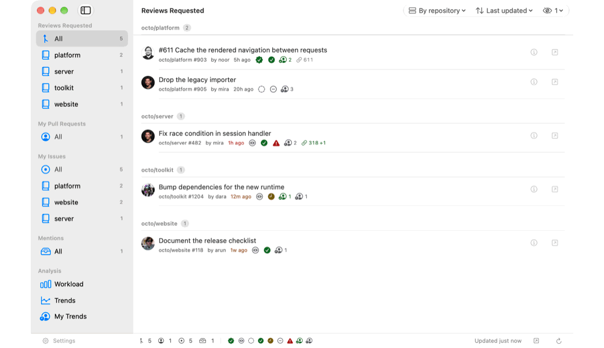
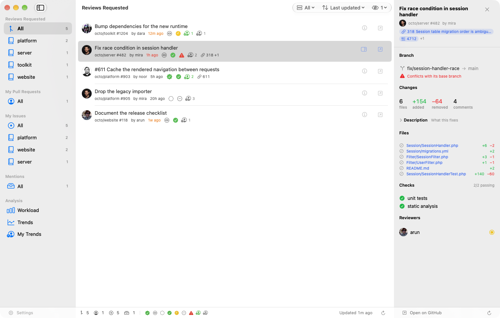
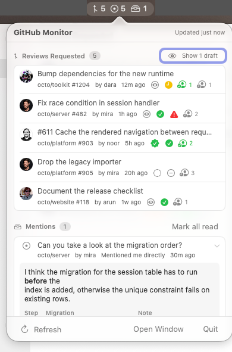
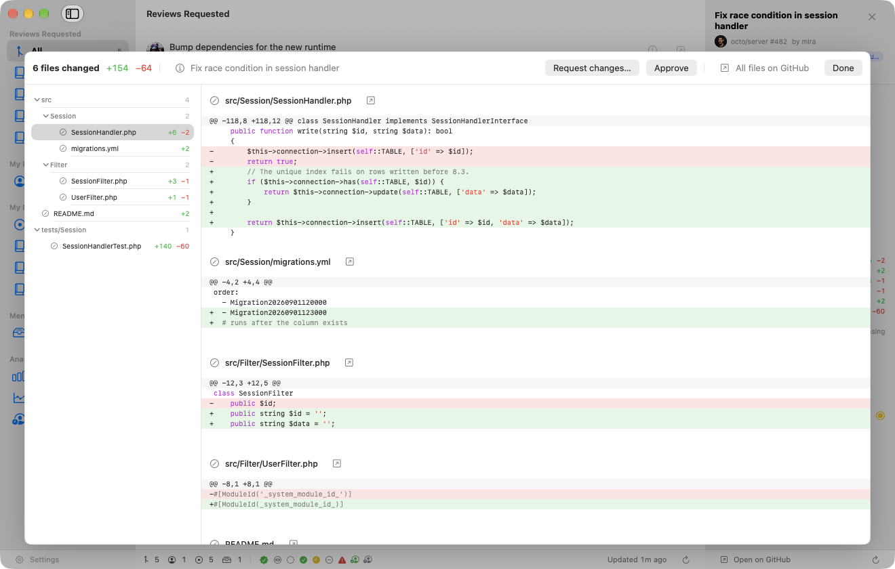
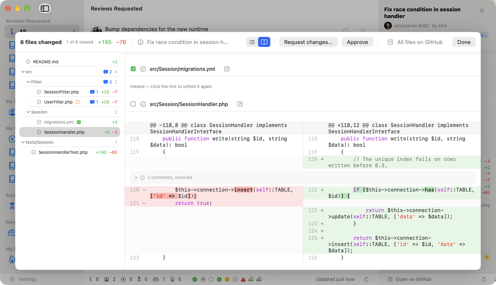
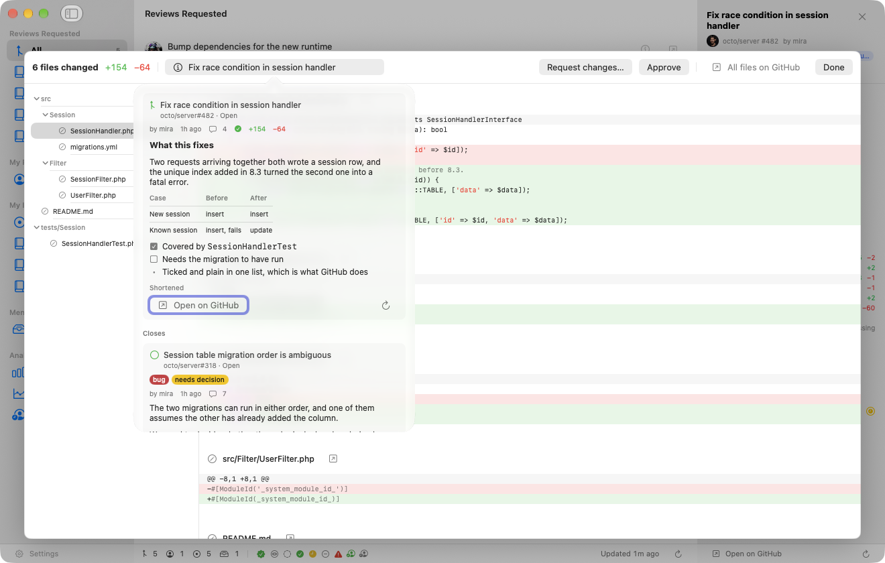
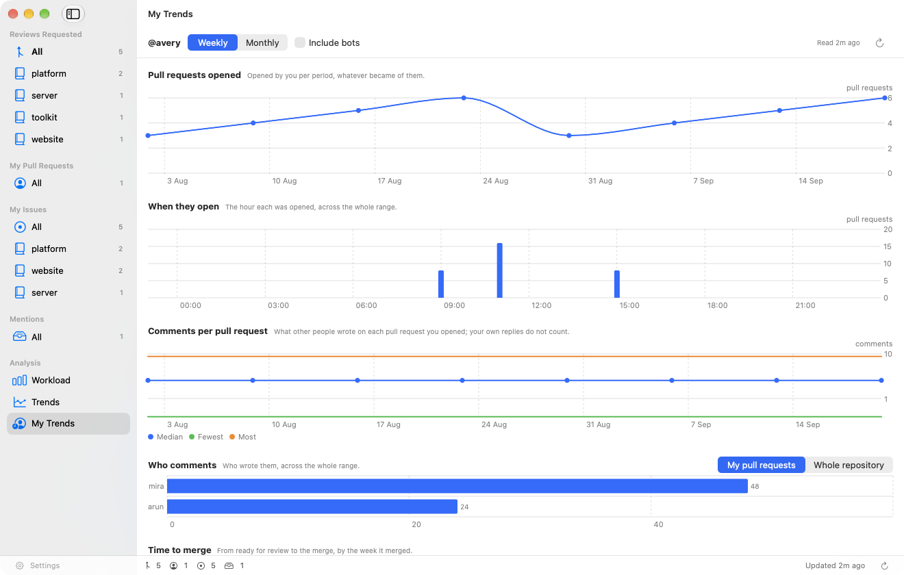

# GitHub Monitor

A macOS menu bar app that shows how much GitHub work is waiting for you — and
lets you do most of the reviewing without leaving it.

The counts live in the menu bar. A popover gives a short overview; a separate
window gives the full lists, the diffs, the charts and the settings.



## In short

**Review without leaving it**

- Every file's patch in one overlay — one column or two, all files or one at a time
- Write remarks on lines, gather them into one review, send it when you are done
- Answer conversations and settle them; `@` offers the people the mention will actually reach
- Approve, request changes, or merge — each bound to the commit you read, refused if somebody pushed since
- Set and clear labels, read a pull request's commits, see the pictures in a description

**Know what is waiting**

- Lists you define, in GitHub's own search syntax, as pull requests or issues
- Rows that answer at a glance: checks, review state, whether it still merges, how long it has waited on *you*
- Unread mentions, from the notifications API
- Charts: who is carrying what, how a repository moves over time, and how you yourself review

**Stay out of the way**

- Counts in the menu bar; the window only when you want it
- What GitHub charged for the last refresh, in plain sight, and polling that stops before the allowance does
- No account anywhere but GitHub: the token lives in the keychain, and nothing else is contacted



## What it does

**Lists you define.** Each is a title and one or more GitHub searches, shown as
pull requests or as issues. It starts with reviews requested of you or your
teams, the pull requests you opened, and the issues assigned to you — all three
editable like any other, and all of them exportable to a file and importable
again. A list's search is GitHub's own syntax, one search per line, results
merged. `@me` is you, and GitHub resolves team membership itself. Lists page to
300 rows and say how many more the search found.



**Unread mentions.** Unread notification threads matching the reasons you care
about. Not a search, so not a list: they come from the notifications API, which
has an hourly allowance of its own.

**Rows that answer at a glance.** Review decision, check results, whether the
pull request still merges into its base branch, how far the review has got, and
how long it has been waiting on *you* — the date turns orange and then red once
your own review has been outstanding too long. Every symbol has a tooltip,
which appears after 300 ms rather than the system's second and a half.

**Sorting and grouping per list.** Last updated, date opened, type, or waiting
longest; flat, by repository, or by type. Drafts shown or hidden. Each list
remembers its own choices.

**A detail pane** for the selected row: branch and merge state, the change
counts, the description rendered as Markdown — folded away by default, so the
rest is not pushed off the pane — every changed file, every check with its
result, and each reviewer with where they stand. Markdown includes tables,
task lists, code fences with syntax highlighting, and quotes.

**The diff, over the window.** Clicking a file opens every file's patch in one
scrolling overlay with a file tree to jump by, because a diff read three words
at a time in a 400-point pane is not read. Files are listed by path, so the
column and the tree beside it move together. Line numbers down the side give
each line's place in both files.



**All the files, or one at a time.** A long scroll is right for a small
review and wrong for forty-three files, where the file you were reading is
easier to scroll past than to find again. A pager in the diff's header — or ⌥←
and ⌥→ — moves a file at a time, and the tree beside it still jumps anywhere.

**Unified or side by side.** One column is what a patch is and fits anywhere;
two columns put the old file beside the new one, which is what you want when a
line was edited rather than replaced. Switched from the diff's own header,
from *View*, or in Settings. Lines too long for their column wrap rather
than scrolling sideways. Side by side lines up a removal with the addition
that answers it only where the two are recognisably the same line — the rest
get a row each, rather than being paired by position with whatever was left
over.

**The words that changed are marked.** On a line that was edited rather than
replaced, the parts that actually differ are drawn bold and on a stronger
band, in either layout. A change in indentation alone is marked too.



**Approving, from the diff.** The approval is bound to the commit whose diff was
on screen: if somebody pushed since you started reading, it is refused rather
than applied to code you did not see. It asks first, says whether auto-merge is
armed, and the list and pane carry the approval straight away. "Request
changes" opens the pull request on GitHub, where a review can be written
against the lines.

**Remarks on the lines, gathered into one review.** The number in the gutter
turns into a plus as the pointer passes it; what you write is kept until you
send the review, so the author is told once rather than five times. Replies to
a conversation go the same way. Everything unsent survives quitting the app,
and is bound to the commit it was written against — if somebody pushes while a
review is half written, it is not quietly attached to code nobody read.

**Conversations where they were written.** Each one stands at its line, settled
ones shut, with the few lines of code it was about where GitHub no longer gives
it a place. Answer or settle from the thread itself; settling happens at once,
an answer waits for the review.

**`@` offers the people it would reach.** Not the members of the repository and
not whoever has touched it, but GitHub's own answer to who a mention there
actually notifies. The list appears at the caret and is driven by the keyboard:
↑ and ↓ choose, ⏎ inserts, escape puts it away.

**Merging.** From the pane, bound to the commit that was read, with the ways
that repository allows and no others. What stands in the way is said rather
than greyed out: a conflict, checks that have not passed, a review that was
asked for and is missing.

**Labels.** The ones an item carries are shown and can be set and cleared from
the pane, against the repository's own list, searchable where it runs to
hundreds. The ones already on it come first.

**Pictures in a description** are drawn rather than linked, including the
private attachments GitHub serves only to somebody signed in. A small picture
stays small; a click opens it full size without leaving the app.

**A pull request's commits**, newest first, with each one's own checks — so the
list says not only what was done but when it went green. Read only when you
open the section; the count beside the other numbers costs nothing.

**Linked issues and pull requests.** What GitHub itself links, plus numbers
written at the head of a title or in a description. A panel — the same one from
the list, from both detail panes and from the diff — summarises the other side
without leaving what you were reading.



**Charts.** *Workload* is one repository's open pull requests per author, ready
and draft as separate segments. *Trends* follows a repository over time. *My
Trends* is about you: how long reviews wait on you, how fast you answer, and
who you review with.



**A sidebar that follows your lists.** Every list switched on for the window
appears in it, each with the repositories its rows actually came from
underneath — one click narrows the view to that repository's share of that
list. A list covering a single repository can have that row hidden, since it
would only repeat a count that already covers everything.

**The hourly budget, in plain sight.** Settings report what GitHub actually
charged for the last refresh and what that comes to over an hour, read from
GitHub's own figure rather than estimated. Refreshing stops on its own when the
allowance runs low and picks up again when it is restored.

## Install

```bash
brew tap sidler/tap
brew trust --cask sidler/tap/githubmonitor
brew install --cask githubmonitor
```

Homebrew asks you to trust a tap that is not its own before it will run
anything from it — the middle line is that consent, and it is needed once.

Or take the zip from [the latest
release](https://github.com/sidler/GitHubMonitor/releases/latest), unpack it
and move `GitHubMonitor.app` to `/Applications`.

Either way the app is signed with a Developer ID and notarised by Apple, with
the ticket stapled to the bundle, so it opens without a Gatekeeper warning and
without needing the network the first time:

```
$ spctl --assess --type execute /Applications/GitHubMonitor.app
/Applications/GitHubMonitor.app: accepted
source=Notarized Developer ID
```

The app has no Dock icon; look for its icon in the menu bar.

## Requirements

- macOS 26 or later — the app uses the system's own glass materials rather than
  reproducing them
- A classic GitHub personal access token — see [Setting up the
  token](#setting-up-the-token)

To build it yourself you also need a Swift 6 toolchain. Xcode is not required;
the Command Line Tools are enough.

## Build and run

```bash
make run
```

This compiles the package, assembles `.build/GitHubMonitor.app`, ad-hoc signs it
and launches it. Other targets:

| Target | Purpose |
|---|---|
| `make build` | Compile only |
| `make bundle` | Compile and assemble the signed `.app` |
| `make install` | Copy the app to `/Applications` and launch it |
| `make uninstall` | Remove it from `/Applications` |
| `make icon` | Regenerate `AppIcon.icns` from `Resources/AppIcon.svg` |
| `make test` | Run the unit tests |
| `make clean` | Remove build artifacts |

Install before enabling *launch at login*: the login item records the app's
path, so an app running from `.build/` loses its entry on the next clean. If
the setting was already on, switch it off and on again after installing.

The app has no Dock icon; look for its icon in the menu bar. `make run` kills a
previously running instance first.

To open a specific surface straight away — useful for screenshots, since the
app otherwise only reacts to a click on the status item — pass `--open` with
`popover`, `mentions`, `dashboard`, `trends`, `myTrends`, `settings` or a
list's id. `--sample` fills the app with made-up data so the whole interface
can be exercised without a token.

```bash
open -n /Applications/GitHubMonitor.app --args --open settings --sample
```

`settings:general` opens a particular settings tab. `--big` fills the sample
pull request with a review of forty-three files and a couple of thousand
changed lines, which is where the diff's scrolling is worth looking at.
`--fail` marks the last
refresh as failed on top of the sample data, which is how to see what the menu
bar does when GitHub does not answer. `--theme dark` or `--theme light` draws
the app in one of them whatever the Mac is set to, which is how to look at
both without changing a system-wide preference — worth doing for anything to
do with colour, since a contrast that holds in one theme can fail in the
other. The same switches are read from the
environment as `GHM_OPEN`, `GHM_SAMPLE`, `GHM_BIG`, `GHM_FAIL` and
`GHM_THEME`, which is what to use
when launching the binary directly rather than through `open`.

### Signing

Run this once before the first build:

```bash
./Scripts/create-signing-certificate.sh
```

It creates a self-signed code signing certificate in your keychain, and the
Makefile picks it up automatically.

If the script fails on the keychain import, use Apple's own route instead —
it does not go through PKCS#12 and is the more reliable of the two:

1. Open **Keychain Access**
2. Menu: *Keychain Access → Certificate Assistant → Create a Certificate…*
3. Name `GitHub Monitor Dev`, Identity Type *Self Signed Root*,
   Certificate Type **Code Signing**
4. Tick "Let me override defaults" and accept every following screen
5. Run `make bundle` — it finds the certificate on its own

Either way, `make bundle` prints which identity it used.

Without it the build falls back to an ad-hoc signature, which is *not* an
identity: Little Snitch reports "the process has no code signature" and asks
again after every build, and the Keychain treats each build as a different
application, so the stored token needs re-authorising every time. With the
certificate, both ask once and then remember.

### Releasing a signed, notarised build

`make release` builds, signs with a Developer ID, submits the result to
Apple, staples the ticket and then checks what another Mac will conclude.
Two things have to be arranged once before it works, and neither can be done
from the command line:

1. **A "Developer ID Application" certificate.** From the paid Apple
   Developer Program: create a certificate request in Keychain Access
   (*Certificate Assistant → Request a Certificate From a Certificate
   Authority*), upload it at developer.apple.com under *Certificates*,
   download the `.cer` and double-click it. The other certificate types do
   not work — "Apple Development" is for testing, "Apple Distribution" is
   for the App Store.
2. **Notarisation credentials**, stored once under a profile name:

   ```bash
   xcrun notarytool store-credentials "GitHubMonitor" \
     --apple-id you@example.com --team-id YOURTEAMID \
     --password <an app-specific password>
   ```

   The password is an app-specific one from appleid.apple.com, not your
   Apple ID password.

Signing alone is not enough: since macOS 10.15 an app that is signed but not
notarised is refused with "Apple cannot check it for malicious software".
Notarising without stapling leaves it needing the network on first launch.
The target does all three and then asks `spctl` — Gatekeeper's own verdict —
whether it would let the result run.

Publishing a release is three more steps: tag it, attach
`.build/release-app/GitHubMonitor-<version>.zip` to a GitHub release, and
update `version` and `sha256` in the cask at
[sidler/homebrew-tap](https://github.com/sidler/homebrew-tap). Take the
checksum from the file GitHub serves rather than the local one — they should
match, and it costs one `curl` to know rather than assume.

`CFBundleVersion` is not edited by hand. `Scripts/assemble-bundle.sh` writes
the number of commits into the bundle at build time, so it rises on its own
for anything that compares builds. It does mean the release has to be built
after the version commit, or the number belongs to the previous state.

The whole sequence is written down as a skill, in
[`.claude/skills/release`](.claude/skills/release/SKILL.md).

### Network access

The app talks to `api.github.com` and `avatars.githubusercontent.com`. If you
run a firewall such as Little Snitch, allow those two hosts for GitHubMonitor.

## Setting up the token

The app needs a **classic** personal access token. Fine-grained tokens do not
reliably cover the notifications API.

1. Open <https://github.com/settings/tokens> → *Generate new token (classic)*
2. Give it a name such as `GitHub Monitor` and an expiry you are comfortable with
3. Tick these scopes:
   - `repo` — read pull requests, including private repositories
   - `notifications` — read notification threads and mark them read
   - `read:org` — list your team memberships so the app can offer them for selection
4. Copy the token and paste it into the app under *Settings → Account*

> **Note on `repo`:** this scope grants read **and write** access to all your
> repositories. The app only reads, but the token itself is more powerful than
> strictly necessary. This is a GitHub limitation of classic tokens — there is no
> read-only variant that still covers private repositories.

When the token expires, the menu bar icon switches to a warning symbol and the
popover tells you what to do.

## Configuration

Settings are split into five tabs.

**Account** — the token, and the teams whose review requests count as yours
(loadable as a checklist from your memberships).

**Lists** — the lists themselves: title, symbol, searches, what they show, and
where each appears (window, popover, menu bar). Drag to reorder; the sidebar,
the popover and the menu bar all follow that order. Lists can be written to a
file and read back, with a confirmation naming what an import would replace.

**Filters**

| Setting | Effect |
|---|---|
| Repositories | Restrict counting to given owners or `owner/repo` entries. "Add from current results" offers what is actually in your lists. |
| Mention reasons | Which notification reasons count towards the badge. With none selected the count stays at zero. |

**General**

| Setting | Effect |
|---|---|
| Menu bar display | All counts / single total / hide zeros |
| Waiting reviews | After how many days a waiting review is marked, and when it is called overdue |
| Sidebar | Whether to hide the repository row when a list covers only one |
| Refresh interval | How often to poll, with what the last refresh cost |
| GitHub's hourly budget | What is left of each allowance, and when it resets |
| Launch at login | Register the app as a login item. The entry points at the app's current location, so moving it afterwards breaks it. |

**Requests**

Every request to GitHub and what came back: when, which call, the status,
how long it took, what the hourly allowance had left, and — where something
went wrong — what GitHub actually said. The successes are there as well,
because a log holding only the failures cannot say whether anything was
working in between, which is the first question about an intermittent one.
Copy puts the whole thing on the clipboard as text.

The last few hundred, in memory only. Nothing is written to disk: this
answers what is happening now, and a file outliving that question would
carry your repository names around for nobody's benefit.

While the main window is open the app behaves as an ordinary application: it
appears in the Dock and the app switcher and shows a menu bar with the usual
shortcuts (Cmd+, for settings, Cmd+R to refresh, Cmd+W to close, and
Cmd+Option+arrows to move the detail pane down the list). Closing the window
returns it to a menu bar agent with no Dock icon.

Cmd+Q closes the window too, rather than ending the app. This one lives in
the menu bar, where its job is to keep watching after you have finished
looking, and Cmd+Q is the keystroke most people press to clear a window off
the screen. Quitting is Cmd+Option+Q, and the Quit button in the menu bar's
own popover.

## The sample content

`--sample` fills the app with made-up repositories and people so the whole
interface can be exercised without a token. It is also where the screenshots
above come from, which is why none of them show real work. The fixtures live in
`Sources/GitHubMonitorKit/Model/SampleData.swift`, and the tests draw on the
same ones, so a row in a test looks like a row in the app.

## Changelog

[CHANGELOG.md](CHANGELOG.md) — the app ships it and shows it under *GitHub
Monitor → What's New*, so it reads the same file rather than a second copy
that would go stale.

## Licence

MIT — see [LICENSE](LICENSE).

## Project layout

```
Sources/GitHubMonitorKit/   All logic and UI (unit testable)
  Model/                    Data models, settings, status bar title logic
  App/                      AppKit shell: status item, windows
  UI/                       SwiftUI views
Sources/GitHubMonitor/      Thin executable bootstrap
Tests/                      Unit tests for the non-UI logic
```
